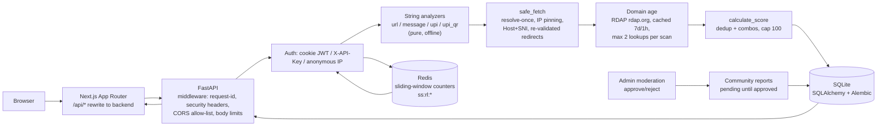
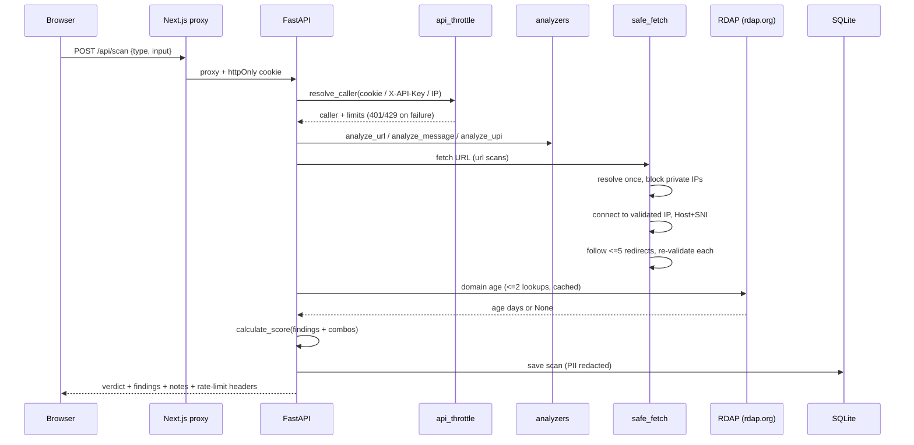
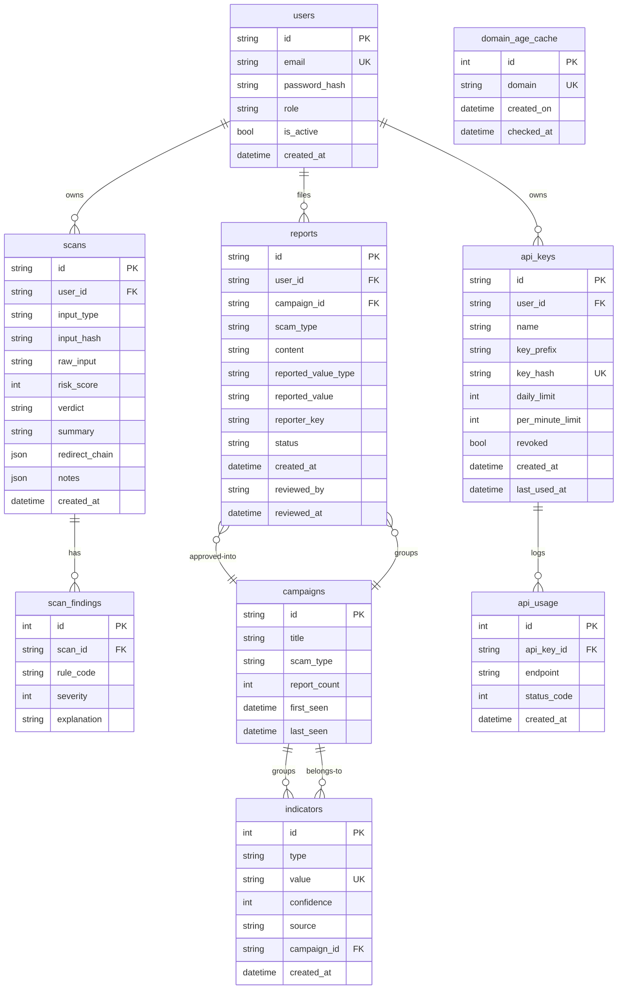

# Architecture

## System diagram

## POST /api/scan sequence

## Database (ER)

## Design decisions (why)

- **Rule-based scoring, no LLM in the loop** (`app/services/scoring.py`): every point maps to a named, testable rule, so verdicts are explainable and deterministic.
- **Analyzers are pure string functions** (`url_analyzer.py`, `message_analyzer.py`, `upi_analyzer.py`): offline, fast, and unit-testable; network/DB effects enter only through explicit parameters (`fetch_result`, `db`, `age_days`).
- **Fetch to pinned IPs, not hostnames** (`safe_fetch.py`): closes the DNS-rebinding time-of-check gap; `Host`/SNI keep virtual-hosting and certificate checks correct.
- **Alembic for schema changes** (not `create_all`): migrations replay/roll back on any copy of the DB, and `test_migration_sync.py` fails CI-style if models drift from migrations.
- **SQLite now, PostgreSQL planned**: one-file zero-setup DB for local dev; `psycopg[binary]` is pinned and migrations avoid SQLite-only DDL so the move is a URL change plus Docker compose (planned).
- **Redis sliding-window limits** (`rate_limit.py`, `api_throttle.py`): one sorted set per caller key (prune-old, count/add, expire in a single MULTI/EXEC pipeline, so replicas can't interleave); keys are `ss:rl:<scope>:<sha256>` so emails/IPs/key ids never reach Redis; `Retry-After` comes from the oldest hit; 1 s Redis timeout with in-memory fallback so a Redis outage weakens limits to per-process instead of breaking requests (logins included).
- **httpOnly SameSite=Lax cookie + same-origin proxy** (`deps.py`, `next.config.ts`): tokens never touch JavaScript; default-empty CORS allow-list because cross-origin is never needed.
- **Hash-only API keys** (`routes_keys.py`, `api_throttle.py`): `ss_live_` keys shown once; only SHA-256 goes to the DB, lookups by hash.
- **Fail-closed auxiliaries**: usage/cache/best-effort lookups may never break a scan (each guarded, each `# nosec`-annotated for bandit).
